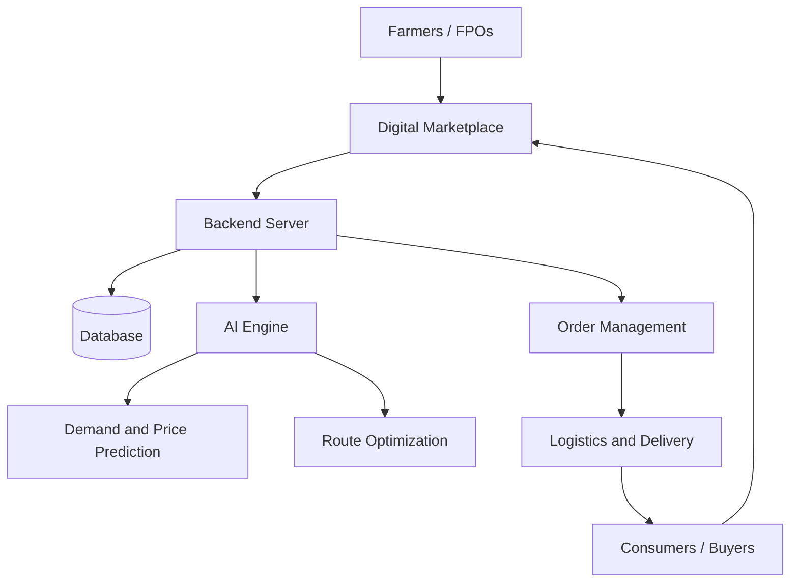

# Smart India Hackathon Workshop
# Date:21-11-2026
## Reference Number:26015763
## Name: Najeeb Mohammed

## Problem Title
SIH 26033: Multiple intermediaries reduce farmers earnings and increase consumer prices.

## Problem Creater's Organization
Ministry of Consumer Affairs, Food & Public Distribution

## Theme
Agriculture, FoodTech & Rural Development

## Problem Description
Expected Solution: Create a digital marketplace that:

• Connects farmers/FPOs directly with consumers and bulk buyers.
• Provides logistics support.
• Uses AI for demand forecasting and route optimization.

Benefits:

• Better prices for farmers.
• Lower prices for consumers.
• Reduced supply chain inefficiencies.

## Proposed Solution
We propose an AI-powered digital marketplace that directly connects farmers, Farmer Producer Organizations (FPOs), consumers and bulk buyers.
Key Features:

Direct buying and selling without unnecessary intermediaries.

AI-based demand and price forecasting.

Smart logistics and route optimization.

Real-time order and delivery tracking.

Transparent pricing and digital payments.

## Technical Approach
The platform consists of four major components:

Farmer Module: Product listing, stock updates and order management.

Consumer Module: Product browsing, ordering and payments.

AI Module: Demand prediction, price analysis and route optimization.

Logistics Module: Delivery assignment and order tracking.

System Architecture:


  Order Processing Workflow:

 ```mermaid
flowchart TD
    A([Start]) --> B[Farmer Lists Products]
    B --> C[Buyer Browses Products]
    C --> D[Selects Products]
    D --> E[Places Order]
    E --> F[Payment Confirmation]
    F --> G[Farmer Receives Order]
    G --> H[Delivery Assignment]
    H --> I[Product Delivered]
    I --> J([Order Completed])
```
## Feasibility and Viability
The solution can be developed using existing web technologies, cloud services and machine learning frameworks.

Challenges and Solutions:

Limited digital awareness – Simple, multilingual interface.

Transportation difficulties – Optimized delivery routes.

Demand fluctuations – AI-based demand forecasting.

Trust and payment issues – Transparent pricing and secure transactions.

## Impact and Benefits
Farmers: Better earnings through direct sales.

Consumers: Access to fresh products at competitive prices.

Businesses: Easier bulk purchasing.

Environment: Reduced food wastage and optimized transportation.

Agriculture: Improved digital connectivity and market access.

## Research and References
Reserve Bank of India (2025) – Agriculture supply chain survey and farmers' share in consumer prices.
https://www.rbi.org.in/Scripts/BS_ViewBulletin.aspx?Id=23198

Reserve Bank of India (2024) – Price dynamics and agricultural value chains of fruits.
https://www.rbi.org.in/Scripts/PublicationsView.aspx?id=22721

Government of India – e-NAM – Digital agricultural marketplace, price discovery and farmer market access.
https://www.enam.gov.in/

Press Information Bureau (2026) – Official information about e-NAM operations and digital agricultural trading.
https://www.pib.gov.in/PressReleasePage.aspx?PRID=2225985

Google Maps Platform – Route optimization for logistics and transportation.
https://developers.google.com/maps/documentation/route-optimization

Scikit-learn – Machine learning tools for predictive analysis and forecasting.
https://scikit-learn.org/stable/
